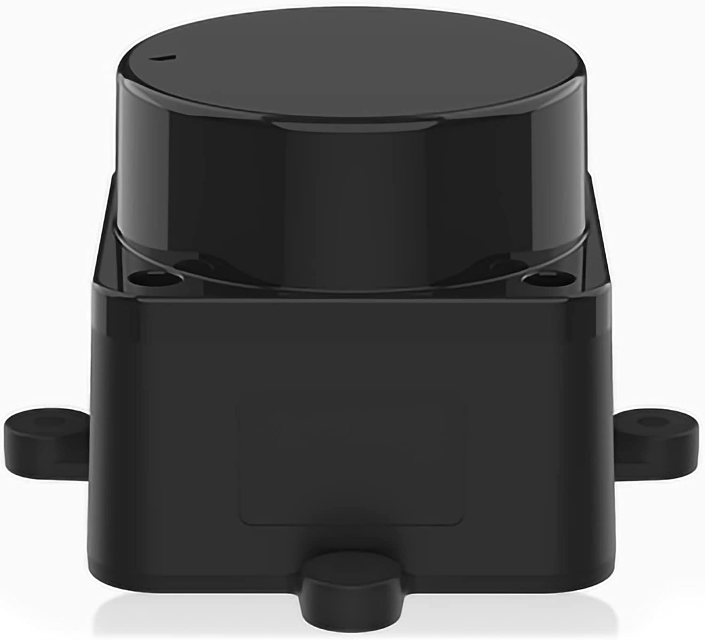
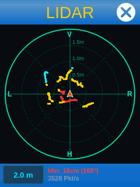
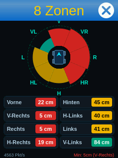

# LD06 LiDAR-Treiber & Apps für fischertechnik ROBOTICS TXT (ftcommunity-TXT)

[](https://github.com/Zwergnase94/FT-txt-ld06-lidar/tags)
[](https://github.com/ftCommunity/ftcommunity-TXT)
[](https://www.ti.com/product/AM3359)
[](https://www.python.org/)
[](https://github.com/harbaum/TouchUI)
[](LICENSE)

Python-Treiber, System-Skripte (udev & automatischer USB-Reset) und zwei Touchscreen-Apps für **LDROBOT LD06 / LD19** sowie **YDLIDAR** (2- und 3-Byte-Protokoll, z. B. mit CP2102 oder CH340) auf dem **fischertechnik ROBOTICS TXT Controller** mit **Community-Firmware (ftcommunity-TXT 1.1.4 / Kernel 4.14 sowie Kernel 6.12+)**.

> **TXT 4.0 im Einsatz?** Für den neueren **fischertechnik TXT 4.0** gibt es ein separates Repository: [FT-txt-4.0-ld06-lidar](https://github.com/Zwergnase94/FT-txt-4.0-ld06-lidar).

---

## Hardware & Screenshots

| Sensor: LD06 LiDAR | App 1: „LIDAR“ (360°-Radar) | App 2: „8 Zonen“ |
|:---:|:---:|:---:|
|  |  |  |
| *LD06 mit CP2102-USB-Adapter* | *Live-Punktwolke mit Zoom* | *Abstandswarnung in 8 Richtungen* |

### Eckdaten des Sensors (LDROBOT LD06)
* **Messprinzip:** Direct Time-of-Flight (DToF), 360°-Rundumscan
* **Abtastrate:** ca. 4.500 Punkte/s bei 10–13 Hz Drehzahl
* **Messbereich:** 0,02 m bis 12 m (Winkelauflösung ca. 0,8°–1,0°)
* **Anschluss:** UART (230.400 Baud) über CP2102- oder CH340-USB-Adapter direkt am USB-A-Port des TXT.

---

## Enthaltene Touch-Apps

Beide Apps erscheinen nach der Installation direkt auf dem Startbildschirm der Community-Firmware.

### 1. App „LIDAR“ – 360°-Radar
* Ressourcenschonendes Rendering über `QPainter` und `TouchStyle` mit gecachtem Hintergrund und `PlainText`-Labels (5 FPS bei geringer CPU-Last auf dem 600-MHz-Prozessor).
* Farbcodierte Punktwolke: **Rot** (< 30 cm), **Gelb** (30–80 cm), **Cyan** (> 80 cm).
* Umschaltbare Zoomstufen per Touch: **1,0 m, 2,0 m, 4,0 m und 8,0 m**.

### 2. App „8 Zonen“ – Hindernis-Dashboard
* Kreisförmige Segmentanzeige rund um das Fahrzeugsymbol sowie acht Kacheln mit Zentimeter-Messwerten (Vorne, V-Rechts, Rechts, H-Rechts, Hinten, H-Links, Links, V-Links; 5 FPS).
* Statuszeile mit dem aktuell nächsten Hindernis (z. B. `Min: 34 cm (Rechts)`).

---

## Technische Besonderheiten auf dem TXT

Damit der LD06 am klassischen ROBOTICS TXT zuverlässig läuft, löst dieses Projekt vier plattformspezifische Hürden (Details unter [`docs/pinout_and_hardware.md`](docs/pinout_and_hardware.md)):

1. **CP2102-Baudrate & Hot-Swap ohne Kernel-Treiber:** Im Kernel von `ftcommunity-TXT 1.1.4` (`4.14.336`) wie auch in neueren `6.12`-Builds fehlt meist `cp210x`; `usbserial_generic` setzt keine Baudrate. [`driver/ld06.py`](driver/ld06.py) konfiguriert den CP2102 daher direkt per USB-Control-Transfer (`0xc0105500`) auf 230.400 Baud. [`system/90-cp2102.rules`](system/90-cp2102.rules) bindet `10c4:ea60` per `cp210x` (falls vorhanden) oder `usbserial` + dynamischem `new_id` – so funktioniert auch ein Sensorwechsel CH340 ↔ CP2102 ohne Neustart.
2. **Automatischer USB-Reset bei `VBUS_ERROR`:** Der kurze Anlaufstrom des LiDAR-Motors kann am TI AM3359 die USB-Schutzabschaltung auslösen (`Vbus off` / `b_idle`). Der Treiber überwacht die MUSB-Sysfs-Pfade für Kernel `4.14` und `6.12+` und reaktiviert den USB-Controller bei Bedarf automatisch über [`system/reset_usb.sh`](system/reset_usb.sh).
3. **Optimiert für 600 MHz ARM & 110–231 MB RAM:** Zero-Allocation-Methoden (`read_into_radar`, `read_into_sectors`, `fill_buffer` außerhalb der UI-Locks) sowie vorberechnete `QPixmap`-Hintergründe, `PlainText`-Statuslabels und Rendering ohne unnötiges Antialiasing entlasten CPU und Arbeitsspeicher deutlich.
4. **Multi-Protokoll-Erkennung & Filter:** [`driver/ld06.py`](driver/ld06.py) erkennt automatisch **LD06/LD19** (`0x54 0x2C`, CRC-8 `0x4D`), **YDLIDAR 3-Byte** und **YDLIDAR 2-Byte** (`0xAA 0x55`, XOR-16). Schwache Reflexionen (`conf < 100`) und Eigenreflexionen am Gehäuse (`dist < 30 mm`) werden gefiltert.

---

## Installation

Per SSH mit dem TXT verbinden (`ssh ftc@<TXT_IP>`) und das Installationsskript ausführen:

```bash
git clone https://github.com/Zwergnase94/FT-txt-ld06-lidar.git /home/ftc/ld06-lidar
cd /home/ftc/ld06-lidar
chmod +x install.sh
./install.sh
```

*(Alternativ das Repository am PC herunterladen und per `scp -r` nach `/home/ftc/ld06-lidar` kopieren.)*

Das Skript installiert udev-Regel, USB-Reset-Freigabe sowie beide Apps und trägt sie auf dem Startbildschirm ein.

<details>
<summary><strong>Manuelle Installation (Einzelschritte anzeigen)</strong></summary>

```bash
# 1. USB-Reset-Skript & Sudoers-Regel
cp system/reset_usb.sh /home/ftc/reset_usb.sh
chmod +x /home/ftc/reset_usb.sh
echo 'ftc ALL = (root) NOPASSWD: /home/ftc/reset_usb.sh' | sudo tee /etc/sudoers.d/usb

# 2. udev-Regel für CP2102 aktivieren
sudo cp system/90-cp2102.rules /etc/udev/rules.d/90-cp2102.rules
sudo udevadm control --reload-rules && sudo udevadm trigger
sudo modprobe usbserial vendor=0x10c4 product=0xea60
# Falls usbserial bereits durch z. B. ch341 geladen ist:
echo 10c4 ea60 | sudo tee /sys/bus/usb-serial/drivers/generic/new_id

# 3. Apps nach /home/ftc/apps/ kopieren
mkdir -p /home/ftc/apps/02eef5e0-981a-11ed-87cd-0800200c9a66
mkdir -p /home/ftc/apps/e8b5a1f0-4567-4f89-8d12-10d6800c9a88
cp -r apps/lidar_radar/* /home/ftc/apps/02eef5e0-981a-11ed-87cd-0800200c9a66/
cp -r apps/lidar_8zones/* /home/ftc/apps/e8b5a1f0-4567-4f89-8d12-10d6800c9a88/
chmod +x /home/ftc/apps/02eef5e0-981a-11ed-87cd-0800200c9a66/main.py
chmod +x /home/ftc/apps/e8b5a1f0-4567-4f89-8d12-10d6800c9a88/main.py

# 4. In /home/ftc/.launcher.xml unter <apps> eintragen und Launcher neu starten:
#    <app path="user/02eef5e0-981a-11ed-87cd-0800200c9a66" />
#    <app path="user/e8b5a1f0-4567-4f89-8d12-10d6800c9a88" />
sudo /etc/init.d/S90launcher restart
```
</details>

---

## Treiber in eigenen Python-Skripten nutzen

```python
import time
from ld06 import LD06

lidar = LD06()

while True:
    for angle_deg, dist_mm, conf in lidar.read_points():
        print(f"Winkel: {angle_deg:5.1f}° | Distanz: {dist_mm / 10.0:5.1f} cm (conf={conf})")
    time.sleep(0.01)
```

Ein Konsolen-Beispiel mit 8-Sektoren-Auswertung liegt unter [`driver/example_cli.py`](driver/example_cli.py) (`python3 driver/example_cli.py`).

---

## Pinbelegung (LD06 an CP2102)

| LD06 Pin | Signal | CP2102-Adapter |
|:---:|:---:|:---|
| **Pin 1 (Rot)** | 5 V | `5V` |
| **Pin 2 (Gelb)** | PWM | *offen lassen (Standard-Drehzahl)* |
| **Pin 3 (Schwarz)** | GND | `GND` |
| **Pin 4 (Weiß/Blau)** | TX | `RXD` |

> [!TIP]
> Läuft der Sensor direkt nach dem Anstecken nicht an, einfach **2–3 Sekunden warten** – der Treiber erkennt die USB-Abschaltung beim Start einer App bzw. beim Verbindungsaufbau und schaltet den Port automatisch wieder frei. Für stabilen Dauerbetrieb empfiehlt sich ein **9-V-Netzteil** am TXT.

---

## Changelog

* **v1.3.0:** Multi-Sensor-Unterstützung mit Auto-Erkennung für LD06 (`0x54 0x2C`) sowie YDLIDAR 2-/3-Byte (`0xAA 0x55`, XOR-16, u. a. über CH340); USB-Reset für Kernel `4.14` und `6.12+`; dynamische `new_id`-Bindung in udev & Installer für Hot-Swap CH340 ↔ CP2102; deutliche UI- und Treiber-Performance-Optimierung (`fill_buffer` außerhalb UI-Lock, `PlainText`-Labels, 5 FPS Radar ohne Punkt-Antialiasing, vorallozierte `8 Zonen`-Brushes) bei voller Python-3.8-/1.1.4-Kompatibilität.
* **v1.2.0:** CRC-8-Paketprüfung (`0x4D`), Signalstärken-Filter (`conf >= 100`) gegen 6-cm-Streulicht-Ausreißer, Nahbereichs-Ausblendung (`< 30 mm`) und ruhigere Sektor-Anzeige (Backport vom TXT 4.0).
* **v1.1.0:** Zero-Allocation-Puffer im Treiber, `QPixmap`-Hintergrund-Caching in beiden Apps und reduzierte CPU-Last (< 15 %).
* **v1.0.0:** Erstveröffentlichung mit CP2102-Userspace-Initialisierung, automatischem USB-Reset, udev-Regel und beiden Touch-Apps.

---

## Lizenz & Autor

* **Autor:** Manuel Neumann ([Zwergnase94](https://github.com/Zwergnase94))
* **Lizenz:** [MIT License](LICENSE)
* **Dank:** An die [ft:community](https://ftcommunity.de/) für `ftcommunity-TXT` und das `TouchStyle`-Framework.
