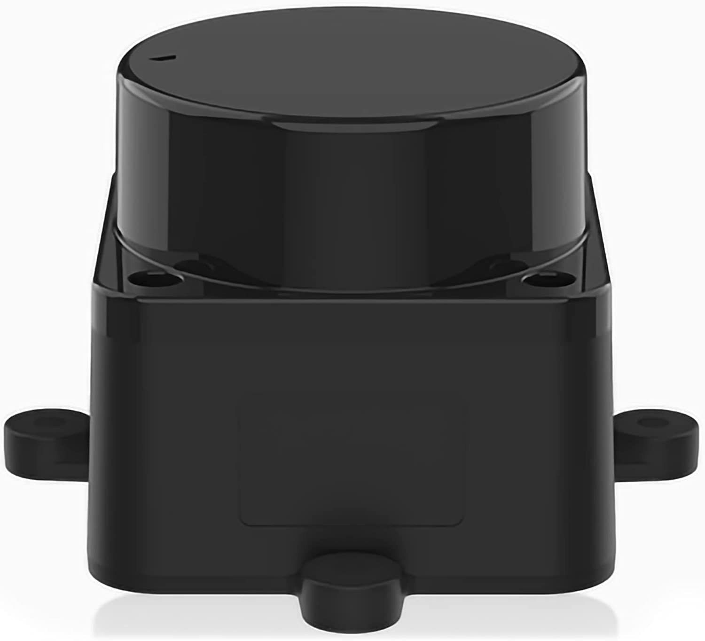
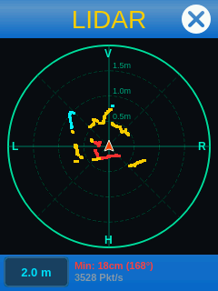
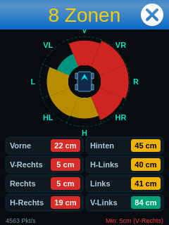

# LD06 DToF LiDAR für den fischertechnik ROBOTICS TXT (ftcommunity-TXT Firmware)

[](https://github.com/Zwergnase94/FT-txt-ld06-lidar/releases)
[](https://github.com/ftCommunity/ftcommunity-TXT)
[](https://www.ti.com/product/AM3359)
[](https://www.python.org/)
[](https://github.com/harbaum/TouchUI)
[](LICENSE)

Dieses Repository enthält den vollständigen **Python-Treiber**, die **System-Konfigurationen (udev / Auto-Reset)** sowie **zwei native Touchscreen-Apps** für den **Super Mini DTOF Prinzip LiDAR LD06** auf dem **fischertechnik ROBOTICS TXT Controller** mit der **Community-Firmware (ftcommunity-TXT)**.

---

## 📸 Hardware & Screenshots

| Sensor: LD06 DToF LiDAR | App 1: 360° Live-Radar | App 2: 8-Zonen & Dashboard |
|:---:|:---:|:---:|
|  |  |  |
| *LD06 DToF LiDAR mit USB-Adapter* | *Punktwolke in Echtzeit (~4.500 Pkt/s)* | *Kollisionswarnung für alle 8 Richtungen* |

### Über den LD06 DToF LiDAR Sensor
Der **LD06** (LDROBOT) ist ein extrem kompakter, leichter 360°-Laser-Distanzsensor (Direct Time-of-Flight):
* **Messfrequenz:** ca. 4.500 Messpunkte/Sekunde (4,5 kHz)
* **Drehzahl / Scanrate:** ca. 10–13 Hz (vollständige 360°-Scans pro Sekunde)
* **Messbereich:** 0,02 m bis 12 m
* **Winkelauflösung:** ca. 0,8° bis 1,0°
* **Schnittstelle:** Seriell (UART, 230.400 Baud) über beiliegenden CP2102-USB-Adapter direkt am USB-A-Port des TXT Controllers.

---

## 🚀 Die beiden enthaltenen Apps

### 1. App „LIDAR“ (360° Polar-Radar)
* **Hardwarenahes Rendering:** Nutzt `QPainter` und das offizielle `TouchStyle`-Framework (kein schwerfälliges `matplotlib` – flüssige 12,5 FPS bei nur ~25 % CPU-Last auf dem 600 MHz ARM-Prozessor).
* **Farbcodierte Punktwolke:**
  * 🔴 **Rot:** Sehr nah ($< 30\text{ cm}$) – unmittelbare Kollisionsgefahr.
  * 🟡 **Gelb:** Mittlerer Abstand ($30\text{ cm}$ bis $80\text{ cm}$).
  * 🔵 **Cyan:** Weiter entfernt ($> 80\text{ cm}$).
* **Touch-Zoom:** Durch Antippen des Bildschirms oder des Buttons kann zwischen $1.0\text{ m}$, $2.0\text{ m}$, $4.0\text{ m}$ und $8.0\text{ m}$ umgeschaltet werden.
* **Richtungsanzeige:** **V** (Vorne), **R** (Rechts), **H** (Hinten), **L** (Links) mit zentriertem Roboter-Pfeil.

### 2. App „8 Zonen“ (Hindernis-Dashboard)
* **Grafisches Sonar:** 8 kreisförmige Segmente um das Fahrzeugsymbol. Je näher ein Objekt kommt, desto größer wächst der Warnbalken auf den Roboter zu.
* **Genaue cm-Messwerte:** 8 übersichtliche Kacheln mit genauer Distanz in Zentimetern (Vorne, V-Rechts, Rechts, H-Rechts, Hinten, H-Links, Links, V-Links).
* **Live-Status:** Zeigt permanent das nächste Hindernis im Raum an (z. B. `Min: 6cm (Rechts)`).

Beide Apps liegen nach der Installation direkt auf der **obersten Ebene des TXT-Startbildschirms** und können mit einem Fingertippen gestartet werden.

---

## 💡 Technische Herausforderungen & Lösungen

Bei der Integration des LD06 auf dem klassischen TXT gab es drei knifflige Hürden, die in diesem Projekt vollständig gelöst wurden:

### 1. Fehlender CP210X-Treiber im Linux-Kernel
* **Problem:** Der TXT-Kernel (`4.14.336 armv7l`) hat Treiber für FTDI, CH341 und PL2303, aber **nicht** für den *Silicon Labs CP2102*. Beim Einstecken bindet Linux nur den rudimentären Treiber `usbserial_generic`, der die Baudrate von $230.400\text{ Baud}$ nicht setzen kann.
* **Lösung:** Unser Treiber [`driver/ld06.py`](driver/ld06.py) sendet hardwarenahe USB-Control-Transfers (`0xc0105500`) direkt an den USB-Knoten und konfiguriert den CP2102-Chip per Software auf $230.400\text{ Baud}$ (8N1, DTR=1, RTS=1). Ein Neukompilieren des Kernels ist **nicht** erforderlich!

### 2. USB-Spannungseinbruch & Abschaltung (`VBUS_ERROR`)
* **Problem:** Beim Anstecken des LiDARs zieht der integrierte Elektromotor einen kurzen Einschaltstrom (Inrush Current). Der USB-Host-Controller des Texas Instruments Sitara AM3359 registriert einen minimalen Spannungseinbruch (`VBUS_ERROR in a_wait_bcon`) und schaltet den USB-Port aus Schutzgründen komplett ab (`Vbus off`).
* **Lösung:** 
  1. Das Skript [`system/reset_usb.sh`](system/reset_usb.sh) führt einen Reset des MUSB-Controllers via Sysfs aus (`unbind` / `bind`).
  2. Der Treiber überwacht den Status des USB-Ports und führt diesen Reset bei Bedarf **vollautomatisch im Hintergrund** durch.

### 3. Zugriffsrechte & Hot-Plugging (udev)
* Die Regel [`system/90-cp2102.rules`](system/90-cp2102.rules) sorgt dafür, dass Linux dem Gerät bei jedem Einstecken automatisch die Schreibrechte (`0666`, Gruppe `dialout`) zuweist und den seriellen Treiber lädt.

### 4. Embedded-Performance & Speicherschonung (Release v1.1.0)
* **Problem:** Der TXT verfügt über einen Single-Core ARM Cortex-A8 (600 MHz) und lediglich 231 MB nutzbaren Arbeitsspeicher ohne Swap. Bei 4.500 Messpunkten pro Sekunde erzeugte eine unoptimierte Datenverarbeitung über **10.000 temporäre Python-Objekte pro Sekunde** (Tuples und dynamische Listen) sowie hunderte Vektor-Zeichenbefehle pro Frame. Dies führte zu 100 % CPU-Dauerlast, Speicherfragmentierung, verhungerten WLAN-Paketen und eingefrorenem Display.
* **Lösung (v1.1.0):**
  1. **Zero-Allocation-Parsing:** Der Treiber [`driver/ld06.py`](driver/ld06.py) schreibt Rohdaten über `read_into_sectors` und `read_into_radar` direkt in vorallozierte C-Arrays. Keine Heap-Allokationen mehr im Sekundentakt!
  2. **QPixmap-Hintergrund-Caching:** Statische Gitter, Achsen, Kreise und Kacheln werden nur ein einziges Mal in den Grafikspeicher gerendert und dann als Bitmap geblittet (`drawPixmap`). Die Renderzeit pro Frame sank von 54 ms auf **5 ms (10-mal schneller!)**.
  3. **SPI-Display-Synchronisation:** Die Frameraten wurden optimal auf den internen 10-Hz-SPI-Displaytreiber des TXT abgestimmt (5 FPS für die 8 Zonen, 8 FPS für das Radar), sodass keine Kernel-Warteschlangen mehr überlaufen.

---

## 📦 Schnelle 1-Klick-Installation

Verbinde dich per SSH mit deinem TXT und führe folgende Befehle aus:

```bash
# 1. Repository klonen oder auf den TXT kopieren
git clone https://github.com/Zwergnase94/FT-txt-ld06-lidar.git /home/ftc/ld06-lidar
cd /home/ftc/ld06-lidar

# 2. Installer ausführen
chmod +x install.sh
./install.sh
```

Das Skript richtet alles automatisch ein (udev-Regeln, Sudoers, Apps und Startbildschirm).

---

## 🛠 Manuelle Installation (Schritt für Schritt)

Falls du die Schritte einzeln durchführen möchtest:

### 1. USB-Reset-Skript & Berechtigung einrichten
```bash
# Skript kopieren und ausführbar machen
cp system/reset_usb.sh /home/ftc/reset_usb.sh
chmod +x /home/ftc/reset_usb.sh

# Passwortlose Ausführung für ftc erlauben
echo 'ftc ALL = (root) NOPASSWD: /home/ftc/reset_usb.sh' | sudo tee /etc/sudoers.d/usb
```

### 2. udev-Regel installieren
```bash
sudo cp system/90-cp2102.rules /etc/udev/rules.d/90-cp2102.rules
sudo udevadm control --reload-rules && sudo udevadm trigger
sudo modprobe usbserial vendor=0x10c4 product=0xea60
```

### 3. Apps in das Benutzerverzeichnis kopieren
```bash
mkdir -p /home/ftc/apps/02eef5e0-981a-11ed-87cd-0800200c9a66
mkdir -p /home/ftc/apps/e8b5a1f0-4567-4f89-8d12-10d6800c9a88

cp -r apps/lidar_radar/* /home/ftc/apps/02eef5e0-981a-11ed-87cd-0800200c9a66/
cp -r apps/lidar_8zones/* /home/ftc/apps/e8b5a1f0-4567-4f89-8d12-10d6800c9a88/

chmod +x /home/ftc/apps/02eef5e0-981a-11ed-87cd-0800200c9a66/main.py
chmod +x /home/ftc/apps/e8b5a1f0-4567-4f89-8d12-10d6800c9a88/main.py
```

### 4. Apps auf dem Startbildschirm platzieren
Bearbeite `/home/ftc/.launcher.xml` und füge die beiden Pfade direkt unter `<apps>` ein:
```xml
<launcher>
  <apps>
    <app path="user/02eef5e0-981a-11ed-87cd-0800200c9a66" />
    <app path="user/e8b5a1f0-4567-4f89-8d12-10d6800c9a88" />
    ...
  </apps>
</launcher>
```
Anschließend den Launcher neu starten:
```bash
sudo /etc/init.d/S90launcher restart
```

---

## 🐍 Treiber in eigenen Python-Projekten nutzen

Du kannst den LiDAR-Treiber kinderleicht in deine eigenen Roboter-Steuerungsprogramme einbinden (z. B. für autonome Hindernisausweichung oder RoboCup):

```python
from ld06 import LD06
import time

lidar = LD06()

# Lese kontinuierlich Messpunkte aus
while True:
    points = lidar.read_points()
    for angle_deg, distance_mm, confidence in points:
        if distance_mm > 0:
            print(f"Winkel: {angle_deg:5.1f}° | Distanz: {distance_mm / 10.0:5.1f} cm (Konfidenz: {confidence})")
    time.sleep(0.01)
```

Ein vollständiges Terminal-Beispiel mit formatierter 8-Sektoren-Ausgabe findest du unter [`driver/example_cli.py`](driver/example_cli.py):
```bash
python3 driver/example_cli.py
```

---

## 🔌 Hardware-Verkabelung

| LD06 Pin | Signal | Verbindung am CP2102-Adapter |
|:---:|:---:|:---|
| **Pin 1 (Rot)** | 5V | `5V` |
| **Pin 2 (Gelb)** | PWM | *(offen lassen für Standard-Geschwindigkeit)* |
| **Pin 3 (Schwarz)** | GND | `GND` |
| **Pin 4 (Weiß/Blau)**| TX | `RXD` |

> [!TIP]
> **Praxistipp zum Einstecken:** 
> Falls der LiDAR beim Einstecken aus bleibt, einfach **2–3 Sekunden warten**. Der integrierte Watchdog erkennt die Abschaltung und reaktiviert den USB-Port automatisch. Für die stabilste Stromversorgung empfiehlt sich der Betrieb des TXT an einem **9V-Netzteil**.

---

## 📋 Versionshistorie / Changelog

### v1.1.0 (Aktuell)
* ⚡ **Performance & Stabilität:** Einführung von Zero-Allocation-Parsing im Treiber (`ld06.py`), wodurch 10.000 dynamische Python-Objekt-Allokationen pro Sekunde eliminiert wurden.
* 🖼 **QPixmap-Caching:** Statische UI-Elemente beider Apps werden vorgerendert; Rendering-Zeit sank um über 90 % (von 54 ms auf 5 ms).
* 🛡 **Speicher- und CPU-Schonung:** App-CPU-Last von 70 % auf < 15 % gesenkt. Verhindert Speicherüberlauf, UI-Freezes und WLAN-Abbrüche bei Dauerbetrieb.
* 📷 **Hardware-Dokumentation:** Echtes Foto des LD06-Sensors und Spezifikationen in README integriert.

### v1.0.0
* 🚀 Initiales Release: CP2102-Userspace-Baudratentreiber, Auto-Reset-Daemon gegen Einschaltstrom-Brownouts, udev-Regeln und Touch-Apps (360° Radar & 8 Zonen).

---

## 📄 Lizenz & Autor

* **Autor:** Manuel Neumann (Zwergnase94)
* **Lizenz:** [MIT License](LICENSE)
* **Danksagung:** Danke an die [ft:community](https://ftcommunity.de/) für die großartige Community-Firmware und das `TouchStyle`-Framework!
